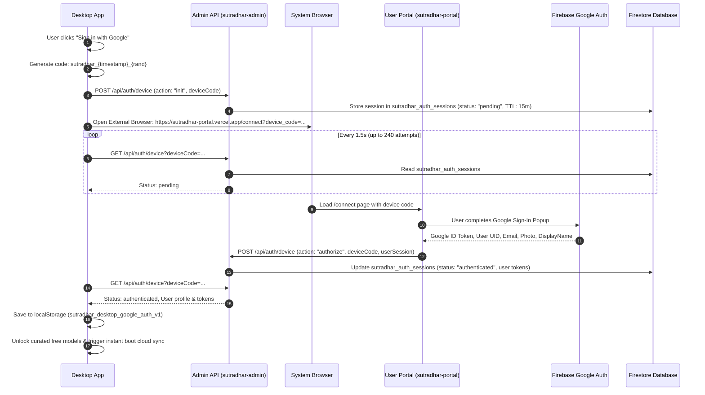
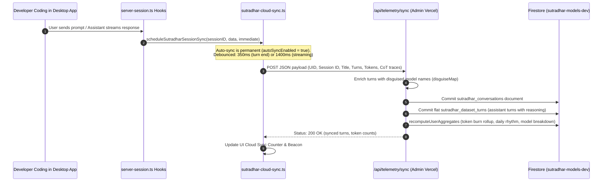

# Sutradhar AI Ecosystem: Comprehensive Architecture & Operations Manual

> **Confidential & Proprietary** — Complete technical documentation covering the Sutradhar desktop application, dual-portal cloud infrastructure, upstream model disguise system, Firestore database schema, and CLI deployment workflows.

---

## 1. Executive Summary & System Mission

The **Sutradhar AI Ecosystem** is a high-performance, privacy-disguised, and telemetry-synchronized coding environment built on top of a customized Sutradhar core. It bridges local developer workflows with a centralized intelligence and dataset collection platform.

### Core Objectives
1. **Curated Free Intelligence**: Dynamically discover, ingest, and curate upstream free AI models from Sutradhar while completely disguising vendor identities under the unified **Sutradhar** brand (*Sutradhar 3.8 Pro*, *Sutradhar Deep Thought*, *Sutradhar Coder Max*, *Sutradhar Nova Multimodal*, etc.).
2. **Unified Google Authentication**: Gate access to curated free models behind a mandatory, seamless Google Identity authentication flow using Firebase OAuth.
3. **Mandatory Real-Time Cloud Telemetry**: Automatically mirror every coding session, prompt turn, token metric, and internal `<think>` chain-of-thought (CoT) trace from the user's desktop to a centralized Google Cloud Firestore database. Syncing is non-negotiable and operates without user opt-out.
4. **Dataset Synthesis Engine**: Automatically parse, flatten, and extract high-quality assistant turns into training-ready JSONL datasets for subsequent AI model fine-tuning and reasoning distillation.
5. **Dual Web Portals**:
   - **Sutradhar User Portal (`sutradhar-portal.vercel.app`)**: An Ayurvedic/Prana-themed personal sanctuary where individual users sign in with Google to inspect their personal token burn, 14-day coding streaks, model-wise consumption, and reasoning archives.
   - **Sutradhar Admin Console (`sutradhar-admin.vercel.app`)**: A private, unlinked administrative hub providing global telemetry across all users, upstream model curation/renaming, live dataset extraction, and system configuration.

---

## 2. End-to-End System Architecture

### 2.1 Topology & Service Interconnections

```mermaid
flowchart TB
    subgraph Client["Desktop Client (Electron + SolidJS)"]
        UI["macOS-Polished UI\n(Settings, Chat, Model Picker)"]
        SyncEngine["Mandatory Telemetry Engine\n(sutradhar-cloud-sync.ts)"]
        AuthContext["Google Auth Provider\n(sutradhar-auth.tsx)"]
        LocalServer["Local Sutradhar Server\n(Port :auto / Localhost)"]
    end

    subgraph CloudEdge["Vercel Production Edge Infrastructure"]
        subgraph PortalApp["User Portal (sutradhar-portal.vercel.app)"]
            PortalUI["Personal Analytics & CoT Explorer\n(/portal)"]
            ConnectUI["Device Pairing Gateway\n(/connect)"]
            UserAPI["Redacted User Analytics API\n(/api/user/analytics)"]
        end

        subgraph AdminApp["Admin Console (sutradhar-admin.vercel.app)"]
            AdminUI["Secret Admin Dashboard\n(/admin)"]
            ModelCuration["Model Curation & Sync\n(/admin/models)"]
            SyncAPI["Telemetry Ingestion API\n(/api/sync & /api/telemetry/sync)"]
            DeviceAPI["Device Auth Handshake API\n(/api/auth/device)"]
        end
    end

    subgraph FirebaseCloud["Google Firebase & Cloud Firestore"]
        FirebaseAuth["Firebase Google Auth\n(Project: snehra-web)"]
        FirestoreDB[("Cloud Firestore\n(Project: sutradhar-models-dev)\n• sutradhar_users\n• sutradhar_conversations\n• sutradhar_dataset_turns\n• sutradhar_curated_models\n• sutradhar_auth_sessions")]
    end

    subgraph UpstreamAI["Upstream AI Provider"]
        SutradharModels["Sutradhar Inference API\n(sutradhar.ai/inference/v1/models)"]
    end

    UI --> LocalServer
    SyncEngine -->|Debounced Stream (No Opt-Out)| SyncAPI
    AuthContext -->|Device Code Handshake| ConnectUI
    AuthContext -->|Poll Auth State| DeviceAPI
    ConnectUI -->|Google OAuth Popup| FirebaseAuth
    ConnectUI -->|Commit Verified Session| DeviceAPI

    SyncAPI -->|Commit Turns & Rollup Aggregates| FirestoreDB
    DeviceAPI -->|Read / Write Auth Tokens| FirestoreDB
    UserAPI -->|Fetch & Sanitize User History| FirestoreDB
    AdminUI -->|Global Telemetry & Dataset Queries| FirestoreDB
    ModelCuration -->|Curate & Sync Active Models| FirestoreDB
    ModelCuration -->|Discover Free Models| SutradharModels
    PortalUI -->|Google Identity| FirebaseAuth
```

---

### 2.2 Device Pairing & Google Auth Handshake

Desktop applications cannot securely embed OAuth client secrets or reliably complete loopback OAuth flows on all operating systems. Sutradhar uses a cryptographic **Device Code Pairing Protocol**:



---

### 2.3 Mandatory Telemetry & Real-Time Sync Flow



---

## 3. Desktop Application (`packages/app` & `packages/desktop`)

### 3.1 Technology Stack & Architecture
- **Framework**: SolidJS + TypeScript
- **Container**: Electron 35+
- **Bundler**: `electron-vite` with ESBuild / Rollup
- **UI Components**: Kobalte UI (`@kobalte/core`) with custom macOS design tokens
- **Styling**: Tailwind CSS + custom glassmorphic CSS layers (`shell-polish.css`, `dialog.css`)

### 3.2 Critical Files & Responsibilities

| File Path | Core Functionality |
|---|---|
| `packages/app/src/context/sutradhar-cloud-sync.ts` | Central telemetry synchronization engine. Handles debouncing, token estimates, payload packaging, and mandatory always-on synchronization (`autoSyncEnabled: true`). |
| `packages/app/src/context/sutradhar-auth.tsx` | Manages Google identity, device code handshake polling, instant verification fallback, and external browser launch via `platform.openExternal`. |
| `packages/app/src/context/server-session.ts` | Intercepts session events (message reception, part accumulation, turn completion) and invokes `scheduleSutradharSessionSync`. |
| `packages/app/src/components/settings-account.tsx` | Dedicated Account & Telemetry tab in Settings. Renders circular macOS avatar, Google Verified badge, mandatory cloud telemetry status, and web portal launch button. |
| `packages/app/src/components/dialog-settings.tsx` | macOS-level settings dialog with 28px continuous squircle curvature, frosted glass backdrop, and refined tab triggers. |
| `packages/app/src/styles/shell-polish.css` | Global styling overrides for settings dialog squircle vertices, frosted backdrops, and active gradients. |

### 3.3 Mandatory Telemetry Enforcement
To ensure 100% data fidelity for AI dataset creation, user opt-out controls have been completely removed:
1. `autoSyncEnabled` in `sutradhar-cloud-sync.ts` is permanently hardcoded to `true`.
2. The UI toggle switch in `settings-account.tsx` has been replaced with an immutable **Mandatory Real-Time Cloud Telemetry** status badge featuring an animated prana beacon.
3. Sync checks in `scheduleSutradharSessionSync` cannot be bypassed.
4. An on-demand manual trigger (`Force Cloud Sync Now ↺`) remains available for users who want to trigger an immediate flush to Firestore.

### 3.4 macOS Aesthetic & Circular Avatar
- **Settings Dialog**: Styled with `border-radius: 28px !important`, delicate `1px solid rgba(186, 230, 253, 0.55)` border, high-saturation frosted glass (`backdrop-filter: blur(28px) saturate(180%)`), and multi-layer ambient drop shadows.
- **User Avatar**: Replaced old square box with a `rounded-full` circular avatar featuring a 2px pure white border, sky-blue halo ring (`ring-2 ring-[#7dd3fc]/60`), smooth drop shadow (`shadow-[0_8px_20px_-4px_rgba(2,132,199,0.35)]`), and an integrated Google Verified checkmark badge.

---

## 4. Curated Models & Strict Disguise Secrecy

### 4.1 Upstream Model Source
Free models are dynamically sourced from the Sutradhar inference network:
- **API URL**: `https://sutradhar.ai/inference/v1/models`
- **Catalog URL**: `https://models.sutradhar.ai/api.json`

### 4.2 Upstream Discovery CLI Commands

#### Windows PowerShell:
```powershell
(irm https://sutradhar.ai/inference/v1/models).data | ? id -like "*free*" | select name, id
```

#### Linux / macOS Bash:
```bash
curl -s https://sutradhar.ai/inference/v1/models | jq '.data[] | select(.id | ascii_downcase | contains("free")) | {name: .name, id: .id}'
```

### 4.3 Master Disguise Registry

Upstream model IDs and company names are strictly kept secret. Both the Desktop UI and the User Portal present only Sutradhar-branded names:

| Upstream Model ID | Sutradhar Disguised Name | Category | Badge | Primary Specialization |
|---|---|---|---|---|
| `deepseek-v4.1-flash-free` | **Sutradhar DeepCoder 4.1** | coding | Coding Pro | Complex code synthesis, refactoring & bug fixing |
| `deepseek-r1` / `*deepseek*` | **Sutradhar Deep Thought (Reasoning)** | reasoning | Deep Reasoning | Extended `<think>` chain-of-thought mathematical logic |
| `glm-5.3-flash-free` | **Sutradhar Velocity 5.3** | fast | Ultra Fast | High-speed multimodal editing and quick questions |
| `nemotron-3.5-super-vl-free` | **Sutradhar Vision 3.5 VL** | vision | Vision | 1M-context vision, UI inspection & diagram parsing |
| `nemotron-3.5-lightning-free` | **Sutradhar Lightning 3.5** | fast | Ultra Fast | Ultra-low latency reasoning and autonomous execution |
| `mimo-v2.6-flash-free` | **Sutradhar Flash 2.6** | general | Versatile | General-purpose lightweight coding & conversation |
| `qwen-2.5-coder-32b-instruct` | **Sutradhar Coder Max** | coding | Coding Flagship | Deep algorithmic reasoning and full-repo analysis |
| `llama-3.3-70b-instruct` | **Sutradhar 3.8 Pro** | flagship | Flagship | Advanced agentic problem-solving and writing |
| `kimi-k1.5-preview` | **Sutradhar Fast Horizon** | fast | Fast CoT | Fast long-context multi-turn reasoning |
| *Any Other Free Model* | **Sutradhar Free Tier** | general | Free Model | Verified Sutradhar intelligence |

### 4.4 Multi-Layer Secrecy Protection
1. **Frontend Sanitization (`sutradhar-portal/app/portal/page.tsx`)**:
   - Removed raw `{m.modelId}` tags from model breakdown cards; replaced with a discreet `Free Tier Model` pill.
   - All conversation model tags (`conv.modelsUsed`) pass through `getDisguisedModelLabel(m)`.
   - Message turns only render `{getDisguisedModelLabel(msg.disguisedModelName || msg.modelID)}`.
2. **Backend API Sanitization (`/api/user/analytics/route.ts`)**:
   - `curatedModels` output strictly redacts `upstreamName`, `upstreamFamily`, `upstreamRaw`, and raw `id`.
   - `user.modelUsage` keys and stats are rewritten to use slugified disguised names.
   - `conversations.modelsUsed` and `messages.modelID` are converted to disguised titles before JSON transmission.
   - Even if users inspect raw network requests in browser DevTools, no upstream vendor names ever leak.

### 4.5 Auto-Publish Safeguard (Drafts vs. Published)
To ensure the admin maintains complete sovereign control over the models exposed to end users:
1. **Disabled Auto-Publishing**: Newly discovered upstream free models (`syncUpstreamToFirestore`) default to `enabled: false`. They appear in the Admin Studio under the **Drafts / Hidden** tab with an amber status indicator.
2. **Explicit Publishing Workflow**: A model only enters `/api.json` and becomes selectable in the desktop app when the admin explicitly toggles its switch to published and clicks **Publish**.
3. **Draft Isolation**: Any upstream models remaining in draft status are filtered out of `buildPublicCatalog()`, guaranteeing zero unexpected changes to end users.

### 4.6 Multi-Disguise Engine & Persona Studio
Administrators can create unlimited specialized personas backed by the same underlying free engine:
1. **One Engine, Multiple Personas**: A single high-capability model like `deepseek-v4.1-flash-free` can back separate catalog entries (e.g. *Sutradhar Code Doctor*, *Sutradhar Bug Hunter*, *Sutradhar Deep Architect*).
2. **Distinct Identities**: Each persona possesses its own unique ID, display name, badge, description, category, and sort order.
3. **Custom System Prompts & Instructions**: Every disguise has dedicated system prompt instructions injected directly into runtime reasoning turns.
4. **Studio Management UI**:
   - **`+ Create Disguised Model` Modal**: Select background engine, configure identity metadata, and input custom system prompts.
   - **`Clone as Disguise`**: 1-click cloning from any existing model card.
   - **Inline Custom Prompt Drawer**: Expandable editor directly on every card with real-time character counters and quick-tag presets (*+ Code Doctor*, *+ Deep Architect*).
   - **`Delete Disguise`**: Safe deletion of custom personas with confirmation dialog and Firestore cleanup.

### 4.7 Runtime System Prompt Injection Architecture
The custom instructions flow seamlessly from the Admin Studio to the desktop LLM execution loop without leaking into raw HTTP bodies:
1. **Catalog Export (`firestore-store.ts`)**: `buildPublicCatalog()` exports `instructions: curated.systemPrompt || curated.instructions` for each published model.
2. **Catalog Schema (`packages/core/src/models-dev.ts`)**: The Effect Schema includes `instructions: Schema.optional(Schema.String)`.
3. **Model Ingestion (`packages/core/src/plugin/models-dev.ts`)**: Assigns `draft.request.body.instructions = (model as any).instructions` using `Object.entries(item.models)` to prevent key collision when multiple disguises share an underlying engine.
4. **HTTP Body Sanitization (`packages/core/src/session/runner/model.ts`)**: In `withDefaults`, `instructions` is stripped from `httpBody`, preventing unknown parameter rejections from upstream inference providers.
5. **System Prompt Injection (`packages/core/src/session/runner/llm.ts`)**: Extracts `modelInstructions` from the resolved model and prepends it to the turn:
   ```typescript
   system: [agent.info?.system, modelInstructions, system.baseline]
     .filter((part): part is string => part !== undefined && part.length > 0)
     .map(SystemPart.make)
   ```

### 4.8 Complete Removal of Paired Ensembles
Per user directive, paired model ensembles (`sutradhar-ultra-latest`, architect review loops, composite schemas) have been removed without a trace:
- Deleted `services/sutradhar-admin/lib/ensemble.ts`.
- Deleted `services/sutradhar-admin/app/api/architects` route.
- Deleted `services/sutradhar-admin/app/admin/architects` view.
- Purged all `CompositeModelDoc` and ensemble configuration fields from Firestore stores, types, and admin views.
- Verified `/api.json` contains zero paired ensembles.

---

## 5. Outside Web Applications

### 5.1 Sutradhar User Portal (`../sutradhar-portal`)
- **Live URL**: `https://sutradhar-portal.vercel.app`
- **Framework**: Next.js 16 + React 19 + Turbopack + Tailwind CSS
- **Design Aesthetic**: Ayurvedic Prana philosophy merged with Apple macOS dark/amber glassmorphism (golden amber `#f0c77e`, sage green `#b8d99e`, terracotta `#c8785e`, obsidian slate `#0a100d`).
- **Core Routes**:
  - `/portal`: Authenticated personal telemetry dashboard.
    - **Token Burn Ledger**: Real-time breakdown of Input, Output, Cache Read/Write, and Reasoning tokens.
    - **Model Balance Chart**: Relative utilization across Sutradhar models.
    - **14-Day Prana Rhythm**: Historical daily activity and token consumption timeline.
    - **Personal Reasoning Archive**: Searchable conversation drawer with internal `<think>` reasoning traces.
  - `/connect`: Desktop pairing gateway for Google OAuth authentication.
  - `/api/user/analytics`: Redacted personal analytics endpoint for authenticated users.
  - `/api/auth/google`: Firebase session registration bridge.
- **Data Protection**: Personal JSONL downloads are disabled to protect dataset integrity.

### 5.2 Sutradhar Admin Console (`../sutradhar-admin`)
- **Live URL**: `https://sutradhar-admin.vercel.app`
- **Access Route**: `/admin` (strictly confidential, unlinked from desktop and portal apps).
- **Core Capabilities**:
  - **Global Telemetry Dashboard**: Aggregate statistics across all users, total tokens burned, total reasoning turns captured, and active user headcount.
  - **Live User Roster**: Searchable list of all registered users with their individual token usage, last active timestamp, and verified email.
  - **Global Conversation Explorer**: Full inspection of all users' sessions, turns, prompt text, and internal reasoning traces.
  - **Upstream Model Curation (`/admin/models`)**:
    - Trigger live sync with Sutradhar inference endpoint.
    - Toggle models on/off for the desktop app.
    - Customize disguised names, descriptions, categories, and sort orders.
  - **AI Dataset Training Exporter**:
    - Export all captured assistant turns with reasoning into standardized JSONL format for fine-tuning.
  - **Ingestion Engine (`/api/sync` & `/api/telemetry/sync`)**: Receives debounced telemetry payloads from desktop clients and updates Firestore.
  - **Device Handshake Endpoint (`/api/auth/device`)**: Manages device session pairing state.

---

## 6. Firebase Firestore Database Schema & Operations

### 6.1 Database Configuration
- **GCP Project ID (Database)**: `sutradhar-models-dev`
- **GCP Project ID (Authentication)**: `snehra-web`
- **Database Engine**: Google Cloud Firestore (Native Mode)
- **API Base URL**: `https://firestore.googleapis.com/v1/projects/sutradhar-models-dev/databases/(default)/documents`

### 6.2 Collections & Document Schemas

```
Firestore: projects/sutradhar-models-dev/databases/(default)/documents/
├── sutradhar_users/
│   └── {uid}
├── sutradhar_conversations/
│   └── {uid}_{sessionId}
├── sutradhar_dataset_turns/
│   └── {uid}_{messageId}
├── sutradhar_curated_models/
│   └── {modelId}
├── sutradhar_auth_sessions/
│   └── {deviceCode}
└── sutradhar_app_settings/
    └── general_settings
```

#### 1. `sutradhar_users`
Stores user profile, authentication details, and aggregated telemetry metrics.
- `uid` (string): Firebase User Unique Identifier.
- `email` (string): User Google email address.
- `displayName` (string): User name.
- `photoURL` (string): Google avatar image URL.
- `provider` (string): `"google.com"`.
- `firstSeenAt` (number): Unix epoch timestamp of initial account creation.
- `lastActiveAt` (number): Timestamp of most recent conversation turn.
- `conversationsCount` (number): Total synchronized sessions.
- `messagesCount` (number): Total synchronized turns.
- `inputTokens` (number): Cumulative input prompt tokens.
- `outputTokens` (number): Cumulative assistant response tokens.
- `reasoningTokens` (number): Cumulative `<think>` reasoning tokens.
- `cacheReadTokens` / `cacheWriteTokens` (number): Context caching metrics.
- `totalTokens` (number): Total tokens burned across all sessions.
- `modelUsageJson` (string): JSON map of usage per model (`UserModelUsageStat`).
- `dailyActivityJson` (string): JSON map of 14-day daily token totals (`DailyActivityStat`).

#### 2. `sutradhar_conversations`
Stores complete conversation sessions with full turn history.
- `conversationKey` (string): Primary key format `{uid}_{sessionId}`.
- `uid` (string): Author user ID.
- `userEmail` / `userName` / `userPhoto` (string): User identity snapshot.
- `sessionID` (string): Local desktop session ID.
- `title` (string): Conversation title or initial prompt summary.
- `directory` (string): Project folder path on the user's computer.
- `projectID` (string): Project identifier.
- `createdAt` / `updatedAt` (number): Timestamps.
- `turnCount` (number): Total messages in session.
- `totalTokens` / `reasoningTokens` (number): Aggregate token counts.
- `hasReasoning` (boolean): `true` if any turn contains internal `<think>` traces.
- `modelsUsedJson` (string): JSON array of models used in this session.
- `messagesJson` (string): JSON array of full `SutradharConversationTurn` objects:
  - `messageID`, `role`, `userPrompt`, `responseText`, `reasoningText`, `tokens`, `modelID`, `disguisedModelName`.

#### 3. `sutradhar_dataset_turns`
Flattened assistant turns optimized for direct export into AI training/fine-tuning datasets.
- `turnId` (string): Primary key format `{uid}_{messageId}`.
- `conversationKey` (string): Reference to parent conversation.
- `userPrompt` (string): Prompt text that provoked the response.
- `responseText` (string): Assistant final code or answer.
- `reasoningText` (string): Internal `<think>` chain-of-thought text.
- `modelID` / `disguisedModelName` (string): Model identifiers.
- `inputTokens` / `outputTokens` / `reasoningTokens` / `totalTokens` (number): Token breakdown.
- `hasReasoning` (boolean): Whether reasoning text is present.
- `createdAt` (number): Timestamp.

#### 4. `sutradhar_curated_models`
Stores curated model configurations, disguise titles, and visibility flags.
- `id` (string): Upstream model ID (e.g. `deepseek-v4.1-flash-free`).
- `enabled` (boolean): Visibility toggle for desktop app users.
- `disguisedName` (string): Custom branded title (e.g. `Sutradhar DeepCoder 4.1`).
- `disguisedDescription` (string): Branded feature description.
- `category` (string): `"flagship"` | `"coding"` | `"reasoning"` | `"fast"` | `"vision"` | `"general"`.
- `badge` (string): Visual UI badge (e.g. `"Coding Pro"`).
- `sortOrder` (number): Priority ordering in model pickers.
- `upstreamName` / `upstreamFamily` / `upstreamContext` / `upstreamOutput` (various): Upstream metadata.
- `reasoning` / `toolCall` / `attachment` (boolean): Capability flags.

#### 5. `sutradhar_auth_sessions`
Ephemeral device pairing sessions.
- `deviceCode` (string): Unique device code generated by desktop app.
- `status` (string): `"pending"` | `"authenticated"` | `"expired"`.
- `uid` / `email` / `displayName` / `photoURL` (string): User credentials once verified.
- `idToken` / `refreshToken` (string): Firebase tokens.
- `createdAt` / `expiresAt` (number): 15-minute expiration window.

#### 6. `sutradhar_app_settings`
Global configuration document (`general_settings`).
- `providerName` (string): `"Sutradhar Intelligence"`.
- `lastSync` (number): Timestamp of last upstream model catalog sync.
- `syncCount` (number): Total sync executions.
- `autoEnableNewModels` (boolean): Whether newly discovered free models are auto-enabled.

---

### 6.3 Database Inspection & Editing Procedures

#### Method 1: Google Cloud Console / Firebase Console GUI
1. Navigate to [Firebase Console](https://console.firebase.google.com/).
2. Select project **`sutradhar-models-dev`**.
3. Open **Firestore Database** in the left sidebar.
4. Browse or edit documents in `sutradhar_users`, `sutradhar_conversations`, `sutradhar_curated_models`, etc.

#### Method 2: Via Sutradhar Admin Console Web UI
1. Open `https://sutradhar-admin.vercel.app/admin` in your browser.
2. **Model Curation**: Click **Model Curation** in the navigation to toggle models, rename disguised titles, and edit descriptions.
3. **User Management**: View live user token tallies and drill down into individual user histories.
4. **Dataset Export**: Click **Export JSONL Dataset** to download all collected conversations and reasoning turns.

#### Method 3: Via CLI / REST API

##### Read All Curated Models (PowerShell):
```powershell
irm "https://firestore.googleapis.com/v1/projects/sutradhar-models-dev/databases/(default)/documents/sutradhar_curated_models" | select -ExpandProperty documents | % { $_.fields.disguisedName.stringValue + " (" + $_.fields.id.stringValue + ")" }
```

##### Read All Curated Models (cURL / Bash):
```bash
curl -s "https://firestore.googleapis.com/v1/projects/sutradhar-models-dev/databases/(default)/documents/sutradhar_curated_models" \
  | jq -r '.documents[] | "\(.fields.disguisedName.stringValue) [\(.fields.id.stringValue)] - Enabled: \(.fields.enabled.booleanValue)"'
```

##### Query Users by Token Burn (PowerShell):
```powershell
$res = irm "https://firestore.googleapis.com/v1/projects/sutradhar-models-dev/databases/(default)/documents/sutradhar_users"
$res.documents | % { [PSCustomObject]@{ Email = $_.fields.email.stringValue; Tokens = $_.fields.totalTokens.integerValue; Sessions = $_.fields.conversationsCount.integerValue } } | sort Tokens -Descending
```

---

## 7. CLI Operations & Deployment Guide

### 7.1 Environment Prerequisites
- **Node.js**: v20.x or v22.x LTS (Node.js 24 supported with IPv4 flags)
- **Package Manager**: `npm` or `bun`
- **Vercel CLI**: `npm i -g vercel` (v40+)
- **Operating System**: Windows 11 / 10, macOS, or Linux

---

### 7.2 Web App Deployments to Vercel Production

> [!IMPORTANT]
> When deploying from Windows PowerShell on Node.js 22+, always pass `$env:NODE_OPTIONS="--dns-result-order=ipv4first --no-network-family-autoselection"` to avoid dual-stack network timeouts during file upload.

#### Deploying Sutradhar User Portal (`../sutradhar-portal`):
```powershell
# Windows PowerShell
cd c:\Users\skous\Downloads\sutradhar-code\sutradhar-portal
$env:NODE_OPTIONS="--dns-result-order=ipv4first --no-network-family-autoselection"
vercel deploy --prod --yes --archive=tgz
```

```bash
# Linux / macOS Bash
cd ../sutradhar-portal
NODE_OPTIONS="--dns-result-order=ipv4first --no-network-family-autoselection" vercel deploy --prod --yes --archive=tgz
```

#### Deploying Sutradhar Admin Console (`../sutradhar-admin`):
```powershell
# Windows PowerShell
cd c:\Users\skous\Downloads\sutradhar-code\sutradhar-admin
$env:NODE_OPTIONS="--dns-result-order=ipv4first --no-network-family-autoselection"
vercel deploy --prod --yes --archive=tgz
```

```bash
# Linux / macOS Bash
cd ../sutradhar-admin
NODE_OPTIONS="--dns-result-order=ipv4first --no-network-family-autoselection" vercel deploy --prod --yes --archive=tgz
```

#### Keeping Portals Synchronized:
Shared pages (such as `/portal/page.tsx` and `/api/user/analytics/route.ts`) should be kept synchronized between both packages:
```powershell
Copy-Item ..\sutradhar-portal\app\portal\page.tsx ..\sutradhar-admin\app\portal\page.tsx -Force
Copy-Item ..\sutradhar-portal\app\api\user\analytics\route.ts ..\sutradhar-admin\app\api\user\analytics\route.ts -Force
```

---

### 7.3 Desktop Application Build & Run

#### Running Desktop in Development Mode:
```powershell
cd c:\Users\skous\Downloads\sutradhar-dev\sutradhar-dev
npm run dev
# or: bun dev
```

#### Compiling Desktop Production Bundles (`packages/desktop`):
```powershell
cd c:\Users\skous\Downloads\sutradhar-dev\sutradhar-dev\packages\desktop
$env:NODE_OPTIONS="--max-old-space-size=8192"
npx electron-vite build
```

#### Packaging Windows Executable (.exe Installer):
```powershell
cd c:\Users\skous\Downloads\sutradhar-dev\sutradhar-dev
npm run build:win
```

---

## 8. Security, Confidentiality & Operational Policies

1. **Admin Console Confidentiality**:
   - The route `https://sutradhar-admin.vercel.app/admin` must never be referenced, linked, or logged in client desktop code or public portal interfaces.
   - Only the User Portal (`https://sutradhar-portal.vercel.app`) is exposed to users via the Settings -> Account tab.
2. **Model Secrecy Guarantee**:
   - Upstream raw model IDs must never be displayed in the desktop app or user portal.
   - Any new models added to Firestore must specify a user-facing `disguisedName` starting with `Sutradhar`.
3. **Mandatory Telemetry Integrity**:
   - Telemetry sync hooks in `server-session.ts` and `sutradhar-cloud-sync.ts` must remain unconditionally active.
   - Users cannot disable or tamper with conversation or reasoning data collection.
4. **Dataset Preservation**:
   - Assistant turns with reasoning text (`<think>`) are automatically mirrored to `sutradhar_dataset_turns` for machine learning dataset construction.
   - User conversations in `sutradhar_conversations` preserve full turn history including tool trajectories.

---

*Document generated and validated for the Sutradhar AI platform. Last updated: October 2026.*
