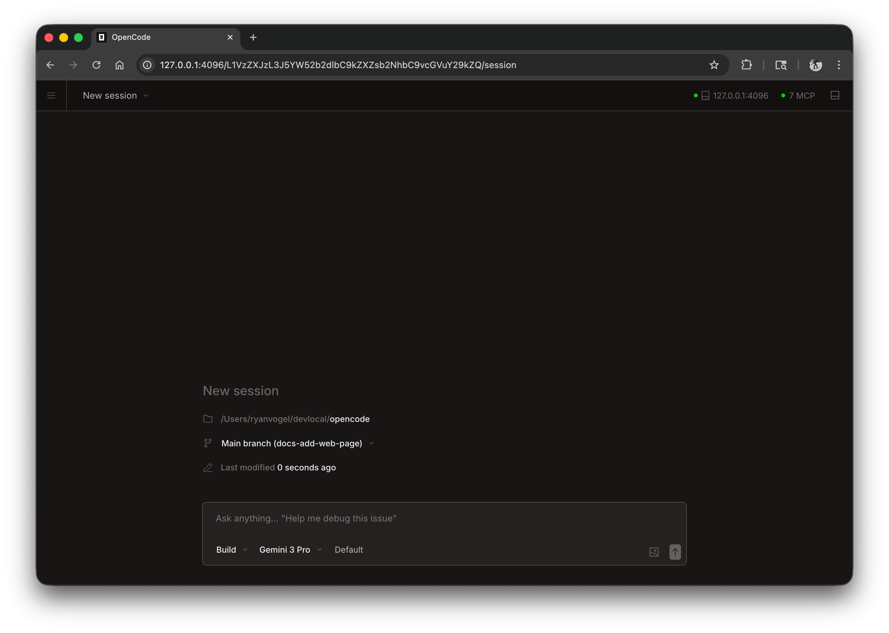
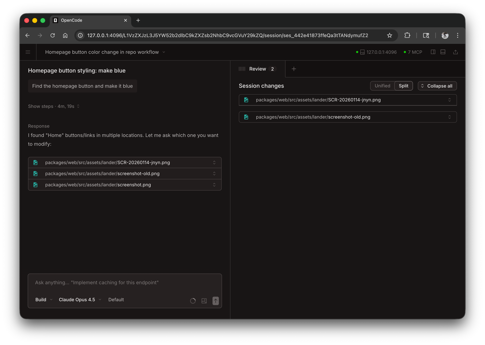
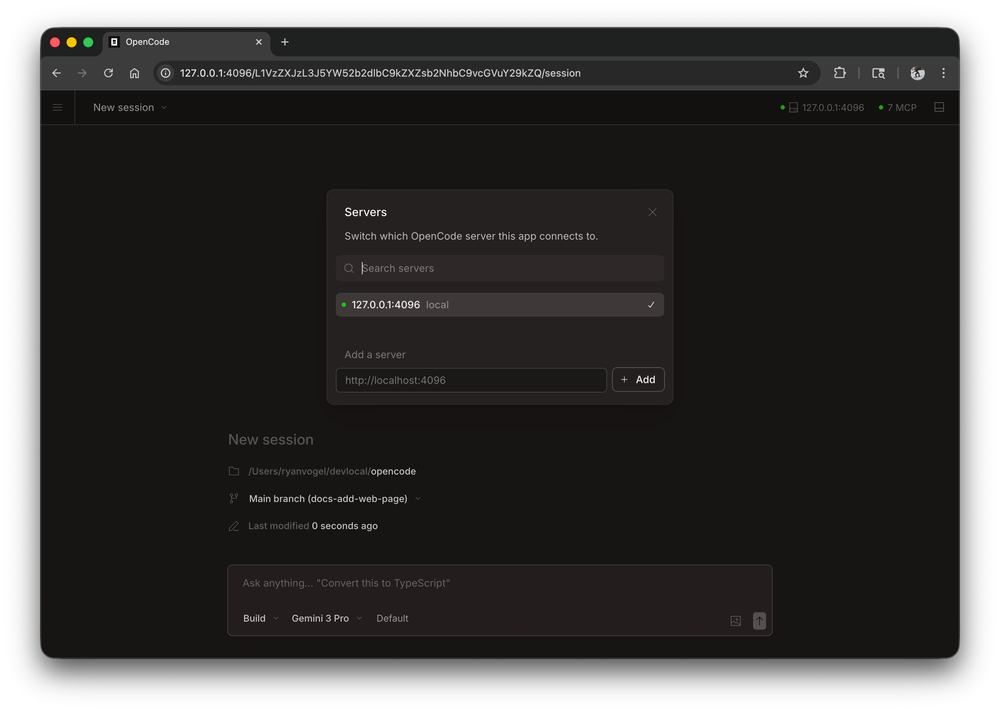

Sutradhar puede ejecutarse como una aplicación web en su navegador, brindando la misma poderosa experiencia de codificación de IA sin necesidad de una terminal.



## Empezar

Inicie la interfaz web ejecutando:

```bash
sutradhar web
```

Esto inicia un servidor local en `127.0.0.1` con un puerto disponible aleatorio y abre automáticamente Sutradhar en su navegador predeterminado.

:::caution
Si no se establece `SUTRADHAR_SERVER_PASSWORD`, el servidor no será seguro. Esto está bien para uso local, pero debe configurarse para acceso a la red.
:::

:::tip[Windows Usuarios]
Para obtener la mejor experiencia, ejecute `sutradhar web` desde [WSL](/docs/windows-wsl) en lugar de PowerShell. Esto garantiza el acceso adecuado al sistema de archivos y la integración del terminal.
:::

---

## Configuración

Puede configurar el servidor web usando indicadores de línea de comando o en su [archivo de configuración](/docs/config).

### Puerto

De forma predeterminada, Sutradhar elige un puerto disponible. Puede especificar un puerto:

```bash
sutradhar web --port 4096
```

### Nombre de host

De forma predeterminada, el servidor se vincula a `127.0.0.1` (solo localhost). Para hacer que Sutradhar sea accesible en su red:

```bash
sutradhar web --hostname 0.0.0.0
```

Al usar `0.0.0.0`, Sutradhar mostrará direcciones locales y de red:

```
  Local access:       http://localhost:4096
  Network access:     http://192.168.1.100:4096
```

### Descubrimiento de mDNS

Habilite mDNS para que su servidor sea reconocible en la red local:

```bash
sutradhar web --mdns
```

Esto establece automáticamente el nombre de host en `0.0.0.0` y anuncia el servidor como `sutradhar.local`.

Puede personalizar el nombre de dominio mDNS para ejecutar varias instancias en la misma red:

```bash
sutradhar web --mdns --mdns-domain myproject.local
```

### CORS

Para permitir dominios adicionales para CORS (útil para interfaces personalizadas):

```bash
sutradhar web --cors https://example.com
```

### Autenticación

Para proteger el acceso, establezca una contraseña utilizando la variable de entorno `SUTRADHAR_SERVER_PASSWORD`:

```bash
SUTRADHAR_SERVER_PASSWORD=secret sutradhar web
```

El nombre de usuario predeterminado es `sutradhar` pero se puede cambiar con `SUTRADHAR_SERVER_USERNAME`.

---

## Usar la interfaz web

Una vez iniciada, la interfaz web proporciona acceso a sus sesiones Sutradhar.

### Sesiones

Vea y administre sus sesiones desde la página de inicio. Puedes ver sesiones activas e iniciar otras nuevas.



### Estado del servidor

Haga clic en "Ver servidores" para ver los servidores conectados y su estado.



---

## Adjuntar una terminal

Puede conectar un terminal TUI a un servidor web en ejecución:

```bash
# Start the web server
sutradhar web --port 4096

# In another terminal, attach the TUI
sutradhar attach http://localhost:4096
```

Esto le permite utilizar la interfaz web y el terminal simultáneamente, compartiendo las mismas sesiones y estados.

---

## Archivo de configuración

También puede configurar los ajustes del servidor en su archivo de configuración `sutradhar.json`:

```json
{
  "server": {
    "port": 4096,
    "hostname": "0.0.0.0",
    "mdns": true,
    "cors": ["https://example.com"]
  }
}
```

Los indicadores de la línea de comando tienen prioridad sobre la configuración del archivo de configuración.
